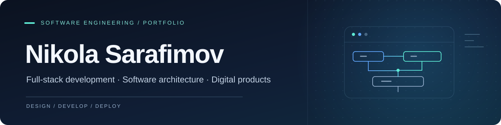

 

**Software Engineering Student · Full-Stack Development · Digital Media**

Building software with attention to architecture, usability, and the details that make products work.

  
  
  

<a href="#about-me">About</a> ·
<a href="#featured-projects">Projects</a> ·
<a href="#engineering-focus">Engineering</a> ·
<a href="#technology-stack">Tech stack</a> ·
<a href="#github-activity">GitHub activity</a> ·
<a href="#creative-work">Creative work</a> ·
<a href="#connect">Contact</a> ·
<a href="#македонски">Македонски</a>

---

## About Me

I'm **Nikola Sarafimov**, a software engineering student at the **Faculty of Computer Science and Engineering (FINKI)**, Ss. Cyril and Methodius University in Skopje, North Macedonia.

I develop **full-stack web applications and backend systems**, with an interest in software architecture, databases, REST APIs, distributed systems, and practical AI integrations. I enjoy working across the complete development lifecycle — from interface design and implementation to testing, deployment, and documentation.

My background in **video production, photography, and visual design** also shapes how I approach user experience and the presentation of digital products.

## Featured Projects

Selected projects showcasing full-stack development, data-driven applications, and product-oriented engineering. The screenshots link to their repositories; live demos are linked where available.

<table>
  <tr>
    <td width="50%" valign="top">
      
      <h3><a href="https://github.com/nikolasarafimov/mk-dictionary-app">Macedonian Dictionary</a></h3>
      
A searchable digital Macedonian dictionary with <strong>1,323,718 word forms</strong>, morphological information, and a production server-side database API.

      
<code>React</code> <code>Vite</code> <code>Turso / SQLite</code> <code>Vercel</code>

      
<a href="https://mk-dictionary-app.vercel.app/home"><strong>Live demo</strong></a> · <a href="https://github.com/nikolasarafimov/mk-dictionary-app"><strong>Repository</strong></a>

    </td>
    <td width="50%" valign="top">
      
      <h3><a href="https://github.com/nikolasarafimov/shelfradar">ShelfRadar</a></h3>
      
A product discovery and inventory platform with nearby store search, price comparisons, stock information, interactive maps, and role-based dashboards.

      
<code>Spring Boot</code> <code>React</code> <code>TypeScript</code> <code>PostGIS</code>

      
<a href="https://shelfradar-yrw2.onrender.com"><strong>Live demo</strong></a> · <a href="https://github.com/nikolasarafimov/shelfradar"><strong>Repository</strong></a>

    </td>
  </tr>
  <tr>
    <td width="50%" valign="top">
      
      <h3><a href="https://github.com/nikolasarafimov/agrisense-ai">AgriSense AI</a></h3>
      
A team-developed agricultural management prototype combining weather data, crop and parcel management, and machine-learning-assisted irrigation recommendations.

      
<code>React</code> <code>Spring Boot</code> <code>FastAPI</code> <code>PostgreSQL</code>

      
<a href="https://agrisense-ai-six.vercel.app"><strong>Live demo</strong></a> · <a href="https://github.com/nikolasarafimov/agrisense-ai"><strong>Repository</strong></a>

    </td>
    <td width="50%" valign="top">
      
      <h3><a href="https://github.com/nikolasarafimov/pet-adoption-platform">Pet Adoption Platform</a></h3>
      
An end-to-end adoption management application for adopters, animal shelters, and administrators, built with layered architecture and role-based workflows.

      
<code>C#</code> <code>ASP.NET Core MVC</code> <code>EF Core</code> <code>Docker</code>

      
<a href="https://pet-adoption-platform-nuvx.onrender.com/"><strong>Live demo</strong></a> · <a href="https://github.com/nikolasarafimov/pet-adoption-platform"><strong>Repository</strong></a>

    </td>
  </tr>
</table>

### More Engineering Projects

| Project | What it demonstrates | Core technologies |
| :--- | :--- | :--- |
| [**Smart Travel Planner**](https://github.com/nikolasarafimov/smart-travel-planner) | Microservices, API Gateway, service discovery, Kafka events, and authentication. Developed with a collaborator. | Java, Spring Cloud, React, Kafka, Keycloak |
| [**CDN Simulator**](https://github.com/nikolasarafimov/cdn-simulator) | Multi-layer caching, request routing, load balancing, and FIFO/LRU/LFU eviction with an interactive visualization. [Live demo](https://cdn-simulator.onrender.com/). | Java, Spring Boot, Thymeleaf, Docker |
| [**MovieTicketMVC**](https://github.com/nikolasarafimov/movie-ticket-mvc-app) | Cinema reservations with real-time seat holds, concurrency-aware booking, and PDF confirmations. | C#, ASP.NET MVC 5, SignalR, SQL Server |
| [**Student Project Management System**](https://github.com/nikolasarafimov/student-project-management-system) | Student–teacher project proposal workflow, role-based access, testing, containerization, and Kubernetes configuration. Developed with a collaborator. [Live demo](https://student-project-management-system-3do9.onrender.com/projects). | Java, Spring Boot, PostgreSQL, Docker, Kubernetes |
| [**Blood Agent**](https://github.com/nikolasarafimov/blood-agent-analysis) | Research/demo workflow for laboratory-report OCR, anonymization, AI-assisted data extraction, and review. **Not for clinical use.** | Python, FastAPI, React, PydanticAI, MinIO |

<strong>Explore academic work and mobile projects</strong>

 

- [**MIS Flutter Labs**](https://github.com/nikolasarafimov/mis-flutter-labs) — Flutter/Dart mobile applications for exam schedules and recipe browsing.
- [**Software Engineering Labs**](https://github.com/nikolasarafimov/se-2024-labs) — Git workflows, control-flow analysis, cyclomatic complexity, and software testing exercises.

You can also [browse all public repositories](https://github.com/nikolasarafimov?tab=repositories).

*Project authorship and collaboration details are documented in the individual repositories.*

---

## Engineering Focus

| Area | Work and interests |
| :--- | :--- |
| **Full-stack development** | Accessible, responsive interfaces connected to reliable application and data layers. |
| **Backend engineering** | REST APIs, validation, authentication, authorization, domain logic, and database design. |
| **Architecture & systems** | Layered architectures, microservices, messaging, caching, and concurrent workflows. |
| **Data & applied AI** | Search, geospatial data, OCR pipelines, and machine-learning-assisted features. |
| **Quality & delivery** | Automated testing, continuous integration, containerization, and reproducible deployments. |

## Technology Stack

Technologies used in academic and portfolio work; experience varies across the stack.

| Category | Technologies |
| :--- | :--- |
| **Programming** | Java · C# · Python · JavaScript · TypeScript · C++ · Dart |
| **Frontend & mobile** | React · HTML/CSS · Vite · Tailwind CSS · Bootstrap · Flutter · Thymeleaf |
| **Backend** | Spring Boot / Spring Cloud · ASP.NET MVC / ASP.NET Core · FastAPI · REST |
| **Data** | PostgreSQL · PostGIS · SQL Server · SQLite / Turso · MySQL · H2 |
| **Infrastructure & tooling** | Git · GitHub Actions · Docker / Compose · Kubernetes · Maven · Gradle |
| **Platforms & integrations** | Entity Framework · Spring Data JPA · Keycloak · Kafka · JWT |

---

## GitHub Activity

Automatically generated from GitHub data. Language distribution reflects repositories, not language proficiency; third-party cards may occasionally be unavailable.

---

## Creative Work

Alongside software engineering, I work with **filming, video editing, photography, and visual design**. I use tools including **Adobe Premiere Pro** and **Adobe Photoshop**, bringing a visual storytelling perspective to my digital projects.

## Languages

- **Macedonian** — Native
- **English**

## Connect

I'm open to conversations about software projects, opportunities, and collaborations.

| Professional | Contact |
| :--- | :--- |
| **Portfolio** | [nikolasarafimov.github.io](https://nikolasarafimov.github.io) |
| **LinkedIn** | [Nikola Sarafimov](https://www.linkedin.com/in/nikola-sarafimov-418753357/) |
| **GitHub** | [@nikolasarafimov](https://github.com/nikolasarafimov) |
| **Personal email** | [sarafimov.nikola12345@gmail.com](mailto:sarafimov.nikola12345@gmail.com) |
| **University email** | [nikola.sarafimov@students.finki.ukim.mk](mailto:nikola.sarafimov@students.finki.ukim.mk) |

Elsewhere: <a href="https://www.instagram.com/nikola.sarafimov/">Instagram</a> · <a href="https://www.youtube.com/@sarafimovproduction">YouTube</a> · <a href="https://www.facebook.com/sarafimovnikola">Facebook</a>

---

<strong>🇲🇰 Македонски — целосна верзија</strong>

 

## Никола Сарафимов

**Студент по софтверско инженерство · Развој на full-stack апликации · Дигитални медиуми**

Создавам софтверски решенија што ги поврзуваат корисничкото искуство, backend системите и инфраструктурата.

### За мене

Јас сум **Никола Сарафимов**, студент на **Факултетот за информатички науки и компјутерско инженерство (ФИНКИ)** при Универзитетот „Св. Кирил и Методиј“ во Скопје.

Мојот фокус е на развој на целосни софтверски решенија што комбинираат квалитетно корисничко искуство, сигурна backend логика, API-интеграции и работа со бази на податоци. Ме интересираат **софтверска архитектура, дистрибуирани системи, cloud deployment и практична примена на вештачка интелигенција**. Особено ми е важно проектите да поминат низ цел циклус — планирање, имплементација, тестирање и поставување во функционална околина.

Покрај софтверскиот развој, се занимавам со **видео продукција, монтажа, фотографија и визуелен дизајн**.

### Избрани проекти

| Проект | Опис |
| :--- | :--- |
| [**Македонски речник**](https://github.com/nikolasarafimov/mk-dictionary-app) | Дигитален речник со пребарување низ **1.323.718 збороформи**, морфолошки податоци и серверска API-интеграција. [Апликација](https://mk-dictionary-app.vercel.app/home). |
| [**ShelfRadar**](https://github.com/nikolasarafimov/shelfradar) | Платформа за пребарување производи во продавници, споредба на цени, проверка на залихи и приказ на интерактивна мапа. [Апликација](https://shelfradar-yrw2.onrender.com). |
| [**AgriSense AI**](https://github.com/nikolasarafimov/agrisense-ai) | Тимски развиена платформа за земјоделски податоци, временски информации и ML-препораки за наводнување. [Апликација](https://agrisense-ai-six.vercel.app). |
| [**Pet Adoption Platform**](https://github.com/nikolasarafimov/pet-adoption-platform) | Систем за вдомување животни со посебни функционалности за корисници, прифатилишта и администратори. [Апликација](https://pet-adoption-platform-nuvx.onrender.com/). |
| [**Smart Travel Planner**](https://github.com/nikolasarafimov/smart-travel-planner) | Проект развиен со соработник, со микросервиси, API Gateway, Kafka, Keycloak и препораки за патување. |
| [**CDN Simulator**](https://github.com/nikolasarafimov/cdn-simulator) | Симулација на CDN-мрежа со повеќеслојно кеширање, рутирање и FIFO/LRU/LFU алгоритми. [Демо](https://cdn-simulator.onrender.com/). |
| [**MovieTicketMVC**](https://github.com/nikolasarafimov/movie-ticket-mvc-app) | Систем за кино-резервации со избор на седишта во реално време, заштита при истовремени резервации и PDF-потврди. |
| [**Student Project Management System**](https://github.com/nikolasarafimov/student-project-management-system) | Проект развиен со соработник за пријавување, прегледување и одобрување студентски проекти. [Демо](https://student-project-management-system-3do9.onrender.com/projects). |
| [**Blood Agent**](https://github.com/nikolasarafimov/blood-agent-analysis) | Истражувачки прототип за OCR, анонимизација и AI-обработка на лабораториски извештаи; **не е наменет за клиничка употреба**. |

**Други проекти:** [Flutter лабораториски вежби](https://github.com/nikolasarafimov/mis-flutter-labs) · [Софтверско инженерство — лабораториски вежби](https://github.com/nikolasarafimov/se-2024-labs) · [Сите јавни репозиториуми](https://github.com/nikolasarafimov?tab=repositories).

### Области на интерес

- **Full-stack развој:** кориснички интерфејси, backend логика и комплетни апликациски процеси.
- **Backend и API:** REST, MVC, автентикација, авторизација, валидација и бази на податоци.
- **Софтверска архитектура:** микросервиси, асинхрона комуникација, кеширање и дизајн на системи.
- **Податоци и AI:** пребарување, OCR, ML-интеграции и геопросторни податоци.
- **Квалитет и испорака:** автоматизирано тестирање, GitHub Actions, Docker и конфигурација на околини.

### Технологии

| Категорија | Технологии |
| :--- | :--- |
| **Програмски јазици** | C#, Java, Python, JavaScript, TypeScript, C++, Dart |
| **Frontend и мобилни апликации** | HTML, CSS, React, Vite, Bootstrap, Tailwind CSS, Flutter, Thymeleaf |
| **Backend** | ASP.NET / ASP.NET Core, Spring Boot / Spring Cloud, FastAPI, REST APIs |
| **Бази на податоци** | PostgreSQL, PostGIS, MySQL, SQLite, Turso / libSQL, SQL Server, H2 |
| **Алатки и инфраструктура** | Git, GitHub, Docker, Docker Compose, GitHub Actions, Kubernetes, Maven, Gradle |
| **Архитектура и интеграции** | Entity Framework, Spring Data JPA, JWT, Keycloak, Kafka, API gateways |

*Наведените технологии се користени во студиски и портфолио-проекти; нивото на искуство се разликува.*

### Креативна работа

Покрај софтверскиот развој, работам со **видео продукција, снимање, монтажа, фотографија и дигитална визуелна обработка**, вклучувајќи ги **Adobe Premiere Pro** и **Adobe Photoshop**.

**Видео продукција:** [Sarafimov Production на YouTube](https://www.youtube.com/@sarafimovproduction)

### Јазици

- **Македонски** — мајчин јазик
- **Англиски**

### Контакт

**Портфолио:** [nikolasarafimov.github.io](https://nikolasarafimov.github.io)  
**LinkedIn:** [Nikola Sarafimov](https://www.linkedin.com/in/nikola-sarafimov-418753357/)  
**GitHub:** [@nikolasarafimov](https://github.com/nikolasarafimov)  
**Лична е-пошта:** [sarafimov.nikola12345@gmail.com](mailto:sarafimov.nikola12345@gmail.com)  
**Факултетска е-пошта:** [nikola.sarafimov@students.finki.ukim.mk](mailto:nikola.sarafimov@students.finki.ukim.mk)

**Социјални мрежи:** [Instagram](https://www.instagram.com/nikola.sarafimov/) · [YouTube](https://www.youtube.com/@sarafimovproduction) · [Facebook](https://www.facebook.com/sarafimovnikola)

---

**Design with purpose. Build with care. Deliver with confidence.**

Explore the repositories to see each project's architecture, implementation, and documentation.

